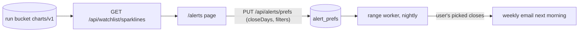
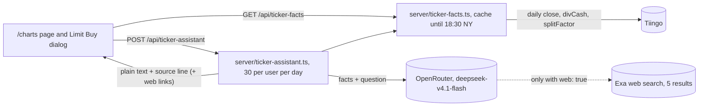

# Architecture

> System flow, auth strategy, state management, cross-cutting structure. Keep it terse: pointers into code, not essays.

- **Layout.** `client/` React SPA (Vite root), `server/` Express API, `shared/` Drizzle schema and contracts used by both, `migrations/` SQL.
- **Routing.** `wouter`, routes in `client/src/App.tsx`. Trace route → page file → inline JSX before editing a section: pages inline their own sections. Unrouted pages and the code only they reached were deleted 2026-10-01 (#13); a page file that exists should be routed.
- **Server entry.** `server/app.ts` (middleware, `registerRoutes` from `server/routes.ts`), `server/index-dev.ts` (Vite middleware), `server/index-prod.ts` (static `dist/public`).
- **FearLab data.** Read-only from the engine's S3 bucket via `server/fearlab-live.ts`; `/api/fearlab/*` routes in `server/routes.ts`; `/charts` in `server/fearlab-charts.ts`. Contracts in `shared/fearlab-contracts.ts`. Offline fallback: `client/public/fearlab/` + `client/src/data/fearlab-snapshot.generated.json`.
- **Accounts and alerts.** Better Auth, email + password (`server/auth.ts`, `server/account-routes.ts`). Watchlist, alert prefs, unsubscribe and Resend webhook in `server/alerts-routes.ts`. The engine worker sends the alert emails. The weekly email's mornings are the user's `closeDays` (shared/alert-settings.ts, read by range `worker/alerts.py`); the `/alerts` ticker picker's month lines come from `GET /api/watchlist/sparklines`, built from the run's `charts/v1/<SYM>.json` and cached 10 minutes.

- **Market data.** Tiingo through a cache (`server/tiingo-cache.ts`, table from `migrations/0005_market_data_cache.sql`); falls back to memory without a database. Refresh is lazy: the first request after the latest weekday 18:30 New York window opens fetches from Tiingo; requests before the next window read the cache (2026-10-01, #12). Nothing refreshes without a visitor.
- **Ticker assistant.** Signed-in only, on `/charts` and in the Limit Buy dialog (`server/charts-app/charts.html`: `#factBand`, `#trendHighlight`, `#askDock`, Limit Buy Table fact columns and `#xpAssist`; quick checks never call the model). `GET /api/ticker-facts?symbols=` (1 to 40 symbols, `{facts, missing}`, no-store) runs `server/ticker-facts.ts`: Tiingo daily `date,close,divCash,splitFactor` over 400 days, with closes and payouts adjusted for splits before anything is computed: price change (not total return) over 21 / 63 / 126 trading bars, overall UP / DOWN / MIXED, distance from the 6-month high, trailing-365-day yield, special-payout flag, and payout cadence from the median gap between payouts (weekly, monthly, quarterly, semiannual, annual or irregular; none without a payout in the trailing 365 days). Cached in memory per symbol until the next 18:30 New York; the page drops its copy at the same time and fetches again. Key: `TIINGO_API_KEY`, else `VITE_T` on production `web`, sent only in the Authorization header. Tiingo's distributions endpoint returns 403 on the current plan, so there are no pay dates; the next payout is an ex-date estimated from cadence. `POST /api/ticker-assistant` (CSRF, own limiter, 30 questions per user per New York day, in memory) runs `server/ticker-assistant.ts`: `deepseek/deepseek-v4.1-flash-1017` through `server/openrouter-ratio.ts` (`OPENROUTER_API`), reasoning effort high and hidden from the stream (`exclude: true`), max_tokens 20000 to leave room for it, provider `data_collection: "deny"`. The model only explains facts the server fetched; the server strips em dashes and appends the source line. Answers follow a fixed plain-text layout (prompt rule 6: one lead sentence, then "- " bullet lines; with web search, "From the facts:" and "From the web:" sections), which the page lays out with `askRenderAnswer` as a bold lead, bullet lists and small headings, from text nodes only. Web search is on unless the visitor unticks "Search the web" under a question box (`#askWeb`, `#xpAskWeb`; not saved, ticked again on every load): a ticked box sends `web: true`, the request adds OpenRouter's web plugin through Exa (5 results, about $0.007 a search, the search built from "About <tickers>: <question>"), the facts stay the only source for the tickers' numbers, and the source line lists the result links, which the page shows as links named by site.

- **Security.** `server/security.ts`: Helmet headers, rate limits, CSRF double-submit (client helper `client/src/lib/csrf-fetch.ts`), input sanitization.
- **No Python on the server.** The runtime image (`node:22-slim`) has no `python3`; server code must not spawn it. Python in this repo is local tooling only (`scripts/regen_fearlab_snapshot.py`).
  retired 2026-10-01: `server/python/usd_correlations.py`, spawned by `GET /api/correlations/usd`; reason: removed in #13, the endpoint returned 500 on every production request and only an unrouted page called it.
